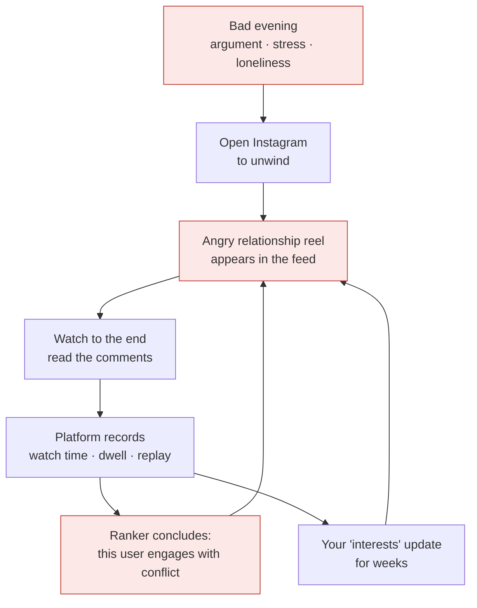
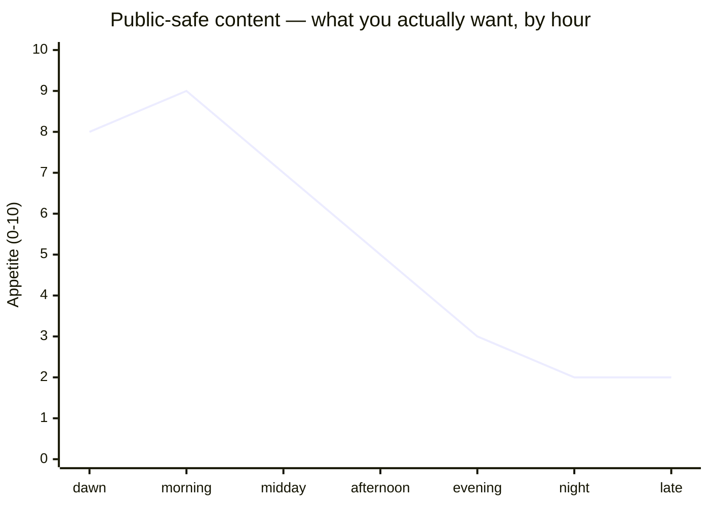
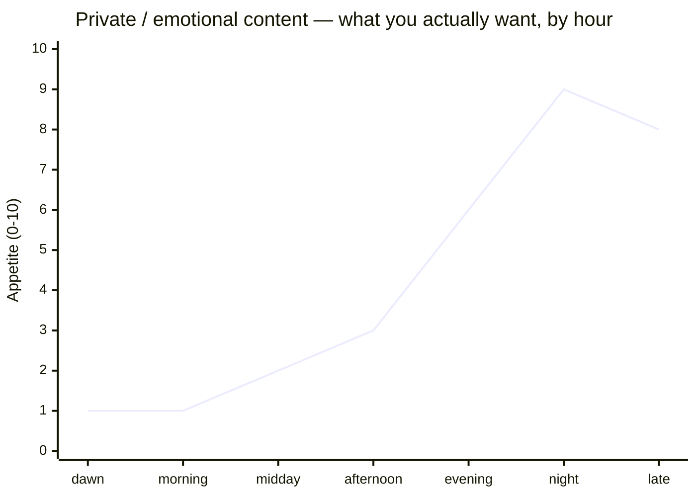
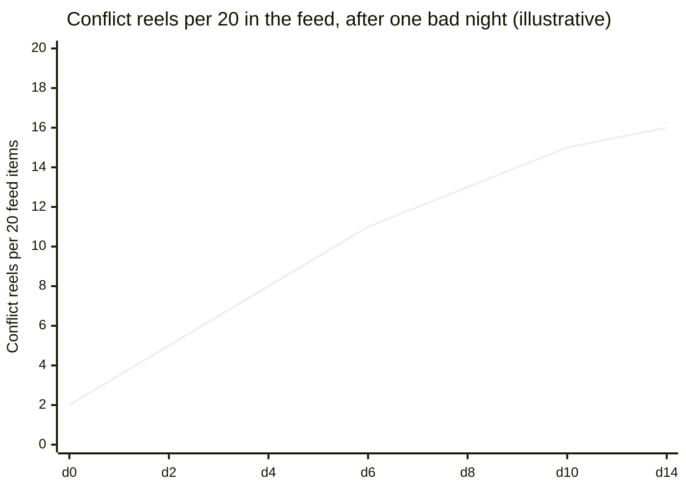
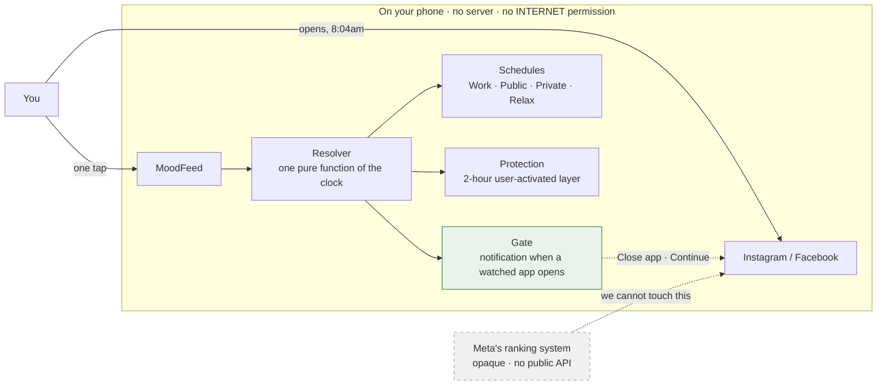
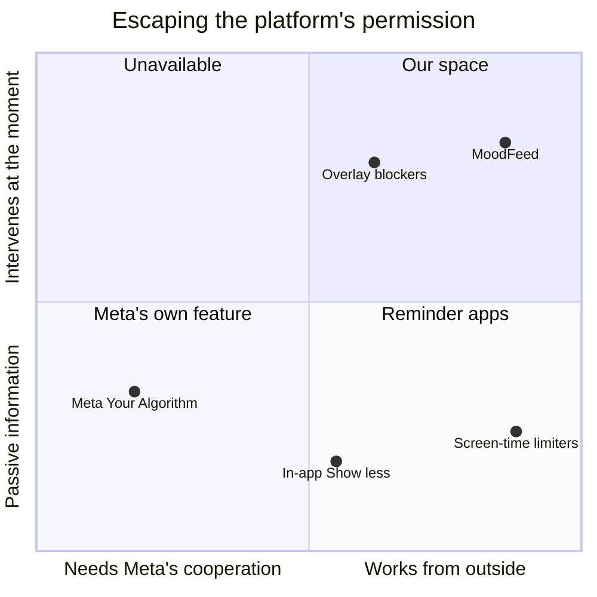
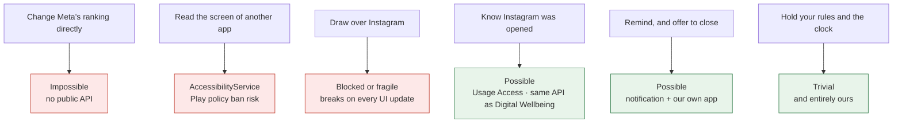
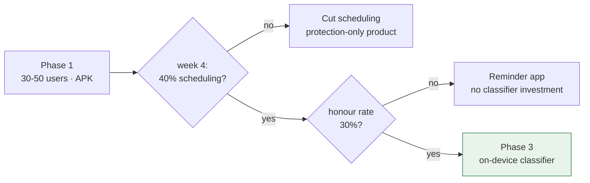

# MoodFeed — The Original Idea and the Problem

> Companion to the Phase 1 contract: [`specs/2026-11-16-moodfeed-design.md`](superpowers/specs/2026-11-16-moodfeed-design.md).
> This document is the *why*. The spec is the *what*.

---

## 1. The idea

A social media feed does not know what kind of day you are having.

It knows what held your attention yesterday. It has no idea whether that attention was wanted, welcome, or the reason you felt worse afterwards.

**MoodFeed is a time-aware control layer between you and the apps you already use.** Not another social network. Not a feed. A thin layer that holds your rules — what you want to see at 8am on a train, at 9pm on a sofa, and on the evening after a hard conversation — and intervenes at the one moment it can: when you open Instagram.

---

## 2. The problem

### 2.1 The loop nobody designed

Read it again with one substitution: **attention is not intent.**

The ranker's job is to predict engagement. Engagement is measurable. Intent is not. So the system learns the only thing it can observe — that conflict content holds you — and treats a bad evening as a preference.

### 2.2 The asymmetry

Every signal the platform collects is a *behaviour*. Every signal that matters to you is a *context*.

| What the algorithm sees | What it cannot see |
|---|---|
| Watch duration | Whether you were doom-scrolling at 1am |
| Replays | Whether you replayed it because it upset you |
| Likes, comments, saves | Whether you were in public, at work, on a train |
| Skips | Whether you were protecting your peace |
| Accounts followed | Whether your interests changed this month |
| Topic and creator metadata | Whether you had an argument an hour ago |

One replayed video can outweigh a year of deliberate choices, because the deliberate choices require a tap and the replay requires nothing.

### 2.3 The day has a shape the feed ignores

These two curves are the entire product thesis. They are illustrative, not measured — measuring them honestly is Phase 5.

The curves cross around 6pm. **The feed serves the same mixture at both times**, because a global ranker has one model of you. Two people with identical histories but different clocks are served identical content.

That gap — between what the clock implies and what the ranker assumes — is the product.

### 2.4 What happens over a fortnight

The line is not the interesting part. The interesting part is that **nothing in the platform has a concept of "this was a bad night, don't learn from it."** There is no signal for a one-off. A temporary state is permanently encoded as a trait.

### 2.5 Why the user cannot just fix it in settings

Instagram offers *Not Interested*, *Show Less*, Hidden Words, Sensitive Content Control, and a suggested-content reset. These are real and they help. They share three limits:

1. **They are global, not temporal.** "Show less relationship content" applies at 8am on the train too.
2. **They require the encounter first.** You must be shown the thing to suppress it.
3. **They are permanent.** There is no two-hour "I'm fragile tonight" toggle that undoes itself.

Meta's own *Your Algorithm* (Nov 2026) fixes the first partly — natural-language preferences — but still answers *"what do you want?"*, not *"what do you want **right now**?"*

---

## 3. What we are building

Three things, in priority order:

1. **A schedule engine.** Profiles per day and hour, resolved from the clock. No stored state machine, so it cannot drift or desync.
2. **Emotional Protection.** One tap → two hours → conflict, breakup and anger content softened, then it switches itself off. *Never* romantic content: a rough evening is not a reason to remove affection. The user activates it; the app never infers a mood.
3. **A gate.** When Instagram comes to the foreground, a notification names the active profile and offers to close the app. One deliberate tap to override. That is the entire enforcement mechanism, stated plainly.

### Where this sits

The top-right quadrant is nearly empty for one reason: intervening at the moment, from outside the app, is the hard combination. It is also the only combination worth building.

---

## 4. The honest ceiling

This must be said in the product, not just the docs. Without it, everything above reads as a promise we cannot keep.

**The product is a controller you can dismiss.** It costs the user one tap. Anyone promising more from outside Instagram is either using a policy-violating API or lying.

---

## 5. The bet, and how it dies

The bet is not "people want different reels at different times." It is that **a user will accept one small friction at the open of an app in exchange for not being defined by their worst evening.**

Three ways this fails, with the number that proves it:

| Failure | Signal | Response |
|---|---|---|
| Nobody cares about schedules | <40% still scheduling at week 4 | The schedule was never the value; protection is. Cut it. |
| The gate is ignored | honour rate <30% | It is a reminder app. Price and position it as one. |
| Only works for the anxious 5% | retention concentrated in a tiny cohort | Narrow the product instead of broadening the audience. |

The classifier — the AI everyone assumes is the product — is deliberately **last**, because it is the most expensive way to learn whether anyone wants this.

---

## 6. What we are not building

Stated so it cannot creep back in:

- **Not another feed.** No content of our own, no creator ecosystem, no algorithmic discovery.
- **Not a parental control product.** Different buyer, different consent surface.
- **Not a moral filter.** Categories are user-chosen labels. Romantic and suggestive content are absent from protection entirely, so the app cannot be read as judging them.
- **Not a diagnosis.** The app never concludes you are struggling. It never activates protection for you.
- **Not a data business.** No `INTERNET` permission in the manifest is a claim you can verify, not a policy you have to trust.

---

## 7. The one sentence

> People should be able to decide what kind of digital environment they enter, without being permanently defined by their previous scrolling.

That is the problem. Everything in the spec is the smallest thing that serves it.

---

*Sources cited in the original brief: Meta Engineering, "Your Algorithm" architecture (Nov 2026); Meta, "Your Algorithm, Your Words"; Meta AI, unconnected recommendations; Google Play, AccessibilityService policy; Apple, Screen Time frameworks.*
